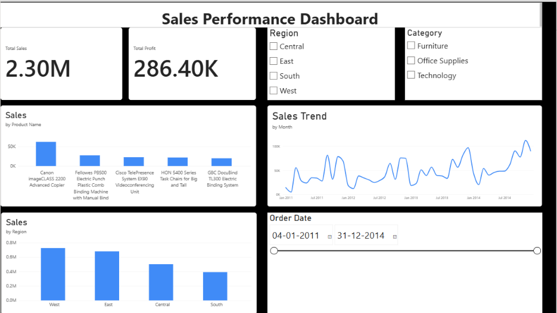
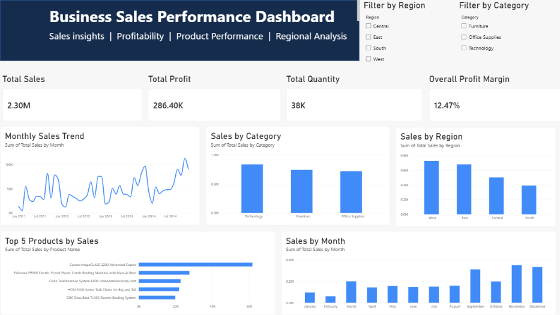

# Business Sales Performance Dashboard

## Overview

This project analyzes business sales data using Microsoft Excel and Power BI. It focuses on sales performance, profitability, product analysis, regional performance, and monthly sales trends.

## Tools Used

- Microsoft Excel
- Power BI Desktop
- Power Query
- DAX
- Data Visualization

## Project Tasks

### Task 1: Sales Performance Dashboard

The first dashboard presents key sales and profit metrics with visualizations for business performance.

**Dashboard Features**
- Total Sales
- Total Profit
- Sales by Product
- Monthly Sales Trend
- Sales by Region
- Region and Category Filters

**Dashboard File:** `powerbi/Sales_Performance_Dashboard.pbix`

**Screenshot**



**Report:** `report/Task_1_Insights_Recommendations.pdf`

### Task 2: Business Sales Performance Dashboard

The second dashboard provides an interactive view of sales, profitability, product performance, and regional and monthly trends.

**Dashboard Features**
- Total Sales
- Total Profit
- Total Quantity
- Overall Profit Margin
- Top 5 Products by Sales
- Sales by Category
- Sales by Region
- Monthly Sales Trend
- Sales by Month
- Region and Category Filters

**Key Performance Indicators**

| Metric | Value |
|---|---:|
| Total Sales | 2.30M |
| Total Profit | 286.40K |
| Total Quantity | 38K |
| Overall Profit Margin | 12.47% |

**Dashboard File:** `powerbi/Task_2_Business_Sales_Dashboard.pbix`

**Screenshot**



## Project Structure

```text
business-sales-performance-dashboard/
├── data/
│   └── Business_Sales_Performance.xlsx
├── powerbi/
│   ├── Sales_Performance_Dashboard.pbix
│   └── Task_2_Business_Sales_Dashboard.pbix
├── report/
│   └── Task_1_Insights_Recommendations.pdf
├── screenshots/
│   ├── dashboard.png
│   └── task_2_dashboard.png
└── README.md
